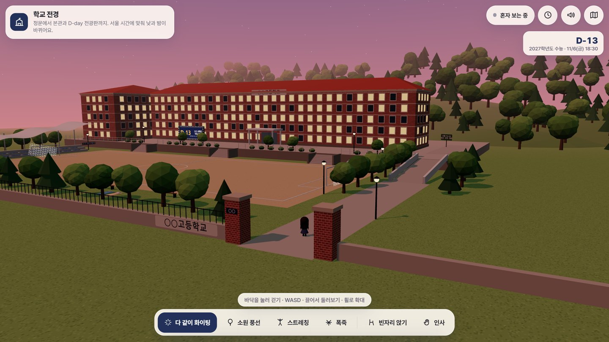
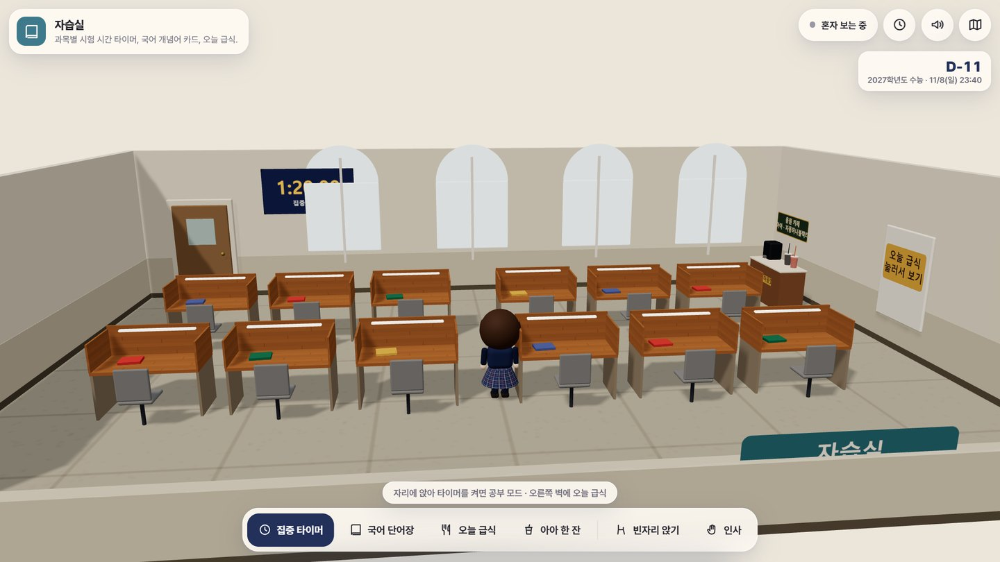

# 수능 응원 공간 — 학교 템플릿

고3 수능을 응원하는 **3D 메타버스 템플릿**입니다. 로그인도 학번 입력도 없이 입장 버튼만 누르면
5글자 별명이 자동으로 붙고, 같은 공간에 들어온 친구들이 서로 보입니다.

이 저장소는 **어느 학교든 자기 버전을 만들 수 있게** 학교 고유 값을 전부 설정 파일로 빼 둔 것입니다.
받아서 `src/data/school.js` 한 파일만 고치면 바로 우리 학교 공간이 됩니다.



| | | |
|---|---|---|
|  |  |  |
| 법당(가상 기원 공간) | 자습실 | 별관 앞 낙엽 벤치 |

> 화면 속 학교 이름은 기본값인 `○○고등학교`입니다. 설정 한 줄만 고치면 우리 학교 이름으로 바뀝니다.

## 15개 공간

| 묶음 | 공간 |
|---|---|
| 우리 학교 | 학교 전경 · 운동장·물결 차양 · 복도 |
| 쉼터 | 본관 뒤 숲길 · 별관 앞 낙엽 벤치 · 옥상 별빛 소원 · 강당 무대 |
| 응원 | 순한맛(천사의 토닥토닥·응원 카페·마음 털기) · 매운맛(불안 블록 부수기) |
| 기원 | 법당 · 성당 · 교회 · 다 빌어 보는 방 — **학교의 실제 시설이 아닌 가상 공간** |
| 공부 | 자습실(집중 타이머·국어 단어장·오늘 급식) · 시험고사장 |

- 서울 시간에 맞춰 낮·저녁·밤이 바뀝니다(밤에는 창문 불, 전광판 전구, 운동장 폭죽).
- 시험고사장은 수능 시간표대로 교시가 흘러갑니다.
- 소리는 음원 파일 없이 Web Audio로 합성합니다.

## 5분 만에 돌려 보기

Node.js 20 이상이 필요합니다.

```bash
npm install
npm run dev
```

브라우저에서 `http://127.0.0.1:5191` 을 엽니다. Firebase를 설정하지 않은 상태에서는
**혼자 보기**로 뜹니다(다른 사람이 안 보일 뿐, 15개 공간은 모두 그대로 동작합니다).

```bash
npm test            # 논리 시험 9개
npm run build       # dist/ 로 정적 빌드
```

주소 뒤에 붙여 쓰는 값: `?space=gate`(바로 그 공간으로) · `?solo`(혼자 보기) ·
`?fresh`(별명 새로 뽑기) · `?space=exam&time=2026-11-19T08:45`(그 서울 시각부터 흘러감).

## 우리 학교 버전으로 바꾸기

### 1단계 — 학교 정보 (필수)

`src/data/school.js` 한 파일만 고칩니다. 간판·전광판·응원 문구·탭 제목이 한꺼번에 바뀝니다.

```js
export const SCHOOL = {
  name: '○○고등학교',          // 교문·본관 간판
  short: '○○',                 // 전광판·응원 문구 (2~3글자)
  appName: '○○ 수능 응원 공간', // 탭 제목
  audience: '○○고 학생·졸업생·선생님·학부모 누구나',
  neis: { office: '', school: '' },  // 급식 (아래 참고)
  examDate: '2026-11-19',            // D-day 기준 날짜
  campus: { annex: '별관' },         // 본관 뒤 건물 이름
};
```

**급식 코드 찾기** — [나이스 교육정보 개방 포털](https://open.neis.go.kr)에서 '학교기본정보(schoolInfo)'로
학교를 검색하면 나옵니다. `office`는 시도교육청 코드(서울 `B10`, 경기 `J10` …), `school`은 7자리 학교 코드입니다.
비워 두면 급식 창만 "설정되지 않았어요"로 뜨고 나머지는 그대로 동작합니다.

공유 미리보기(`og:`)에 쓰이는 제목은 정적이라 `index.html`의 두 줄도 함께 고쳐야 합니다.

### 2단계 — 함께 접속 (선택)

혼자 보기로도 충분하면 넘어가도 됩니다. 친구들이 서로 보이게 하려면 `src/firebase-config.js`에
**자기 Firebase 프로젝트** 값을 채웁니다. 파일 맨 위에 순서가 적혀 있습니다.

1. [Firebase 콘솔](https://console.firebase.google.com)에서 프로젝트 만들기
2. **Realtime Database** 만들기(지역 `asia-southeast1` 권장)
3. **Authentication → 로그인 방법 → 익명** 사용 설정
4. 프로젝트 설정 → 웹 앱(`</>`) 추가 → `firebaseConfig` 값을 붙여넣기
5. 보안 규칙 올리기 — `firebase deploy --only database --project <내-프로젝트-id>`

보안 규칙(`database.rules.json`)은 그대로 쓰는 것을 권합니다. 본인 칸만 쓰기, 빈자리만 앉기,
응원 수는 한 번에 +1만 — 이 세 가지로 남의 자리를 지우거나 숫자를 조작하는 걸 막습니다.

### 3단계 — 학교 모양 (선택)

건물 배치는 코드로 그린 개략 표현입니다. 좌표를 고쳐 자기 학교 모양으로 만듭니다.

- `src/scenes/front.js` — 정문·앞마당·본관·운동장·관람석
- `src/scenes/rear.js` — 본관 뒤 강당·농구장·별관·숲길
- `src/scenes/hall.js` — 복도 색과 문
- `src/engine/avatar.js` — 교복 색

## 올리기 (Firebase Hosting)

```bash
npm run build
firebase deploy --only hosting --project <내-프로젝트-id>
```

`.firebaserc`는 `.gitignore`에 들어 있어 저장소에 남지 않습니다. 프로젝트는 `--project`로 지정하거나
`firebase use --add`로 한 번 등록해 두면 됩니다.

**무료 한도(Spark)** — 실시간 DB 동시 접속 100명, 내려받기·호스팅 전송 각각 하루 360MB.
넘으면 101번째부터 자동으로 혼자 보기로 들어갑니다. 학교 전체에 공지할 때는
Blaze(종량제, 넘는 만큼만 과금)로 올리는 것을 검토하세요.

## 폴더 구조

```
src/
  data/school.js       ★ 학교마다 바꾸는 값 (여기부터)
  firebase-config.js   ★ 함께 접속 설정
  main.js              시작 · 공간 전환 · 접속 연결
  engine/              렌더러 · 카메라 · 조작 · 캐릭터 · 하늘 · 입자 · 소리
  scenes/              공간별 장면 (registry.js 가 15공간 목록)
  data/                별명 · 응원 문구 · 국어 어휘 · 수능 시간표 · 급식 · 서울 시간
  net/presence.js      실시간 접속 (설정 없으면 혼자 보기)
  ui/                  화면 겹침(HUD) · 이름표 · 배율
database.rules.json    실시간 DB 보안 규칙
tests/                 논리 시험 (npm test)
```

## 학생과 함께 쓸 때 — 지켜 둔 것

원작과 이 템플릿이 일부러 **넣지 않은** 기능이 있습니다. 바꿀 때 함께 생각해 보시면 좋겠습니다.

- **글 입력창이 없습니다.** 응원은 준비된 문구에서 고르기만 합니다. 익명 입력창은 사고가 납니다.
- **로그인·학번·이름이 없습니다.** 별명은 1,200가지 중에서 자동으로 붙고, 누가 누군지 알 수 없습니다.
- 등장인물(천사·감독관·시험장 수험생·관객)은 모두 가상입니다. 실제 학생·교직원의 얼굴이나
  이름을 넣지 마세요.
- 기원 공간은 학교의 실제 시설이 아닌 가상 공간임을 화면에 표시해 둡니다.

## 라이선스와 출처

코드와 글은 MIT 라이선스입니다([LICENSE](LICENSE)). 참고한 작품, 쓰인 자료와
라이브러리 출처는 [ASSET_CREDITS.md](ASSET_CREDITS.md)에 있습니다.
